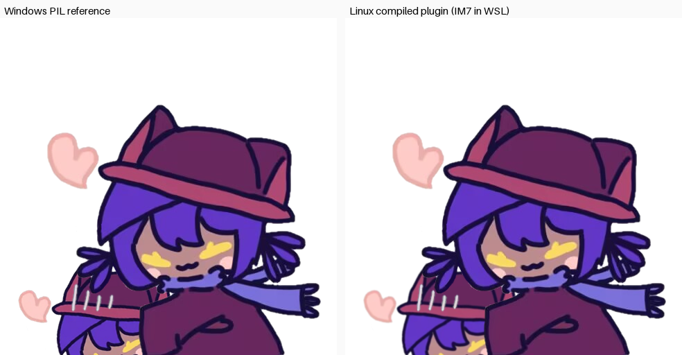

# nikohug

生成「Niko 抱抱」图：把你的 QQ 头像裁成圆形、转个角度，塞进 Niko 怀里。

## 用法

| 输入 | 效果 |
| --- | --- |
| `nikohug` | 抱你自己 |
| `nikohug 114514` | 抱这个 QQ 号 |
| `nikohug @某人` | 抱被 at 的那个人 |

`@某人` 优先级最高，其次是消息里的数字，两者都没有就用发送者自己的 QQ。

## 实现说明

**所有合成在本地完成**，不依赖上游的 HTTP API（`player233-api.onrender.com`
目前已经 404，路由没了）。用到的都是框架既有依赖 `Magick++`，没有引入新依赖。

合成流程（与上游 `main.py` 等价）：

1. 取头像 `https://q1.qlogo.cn/g?b=qq&nk=<QQ>&s=640`
2. 缩放到 300×300，用圆形椭圆蒙版裁切（`DstIn`）
3. 旋转 10°（**注意方向**：上游 Pillow 用 `rotate(+10)` 即逆时针，
   ImageMagick 的 rotate 正方向相反，所以代码里写的是 `-10`）
4. 贴到 486×486 透明画布，内容中心对准 (139, 424)，等价上游的左上角 (-35, 250)
5. 依次居中叠加 `0.png`、`1.png`
6. 输出 PNG，发出去后删掉临时文件

> 为什么不用左上角直接贴：ImageMagick 旋转后画布是 350×350，Pillow 是 348×348，
> 两者扩张尺寸不同。若直接按 (-35, 250) 贴会把头像整体挪位约 2px，
> 所以统一换算成中心点对齐，跟具体扩张尺寸解耦。

## 素材与许可 ⚠️

叠加图 `data/0.png`、`data/1.png` 来自
[player233lol/qq_nikohugapi](https://github.com/player233lol/qq_nikohugapi)，
作者 **player233lol**，许可 **CC-BY-NC 4.0**（署名—非商业性使用）。

- 命名与使用必须保留上述署名。
- **禁止用于商业用途**：一旦本 bot 接入付费服务、收费群或任何营利场景，
  请先移除本插件或取得作者额外授权。
- 上游代码本身作者声明为 CC0；受限的主要是这两张图片素材。

素材被 base64 内嵌进 `nikohug_assets.cpp`，让单个 `.so` 自包含。
首次运行时会把它们释放到框架的 `./resource/nikohug/`，之后直接复用——
**若你维护的部署环境想换成自己的图，直接覆盖该目录下的 `0.png`/`1.png` 即可**，
插件不会重复写入已存在的文件。

## 维护

修改 `data/` 里的素材后需要重新生成内嵌源文件：

```bash
cd functions/nikohug
python gen_assets.py
```

## 编译

`CMakeLists.txt` 由仓库根的 `generate_cmake.py` 生成（已被 `.gitignore` 忽略）。
在 Windows 上可以经由 WSL 编译，见 [docs/BUILD-WINDOWS.md](../../docs/BUILD-WINDOWS.md)：

```bash
bash tools/build-plugin-wsl.sh nikohug
```

产物：`./lib/functions/libnikohug.so`（Linux ELF，供框架 `dlopen`）。

## 已做的校验

| 校验项 | 结果 |
| --- | --- |
| 算法等价性（C++ vs 上游 Pillow） | 平均通道差 **0.22/255**，显著差异像素 **0.61%** |
| 跨平台一致性（WSL 编译产物 vs Windows 参考） | 平均通道差 **0.77/255**，显著差异像素 **0.85%** |
| 真实编译 | WSL Ubuntu 24.04 + ImageMagick 7.1.2-18，`-Wall -Wextra` 零警告 |
| 加载链路 | `dlopen` → `create_t()` → 实例化 → `destroy_t()` 全部通过 |

差异全部来自重采样滤波器（Pillow LANCZOS vs ImageMagick Cubic），肉眼不可分辨。


